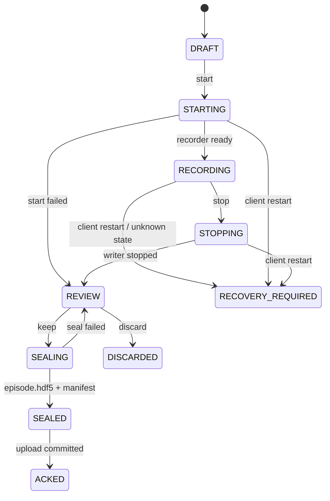
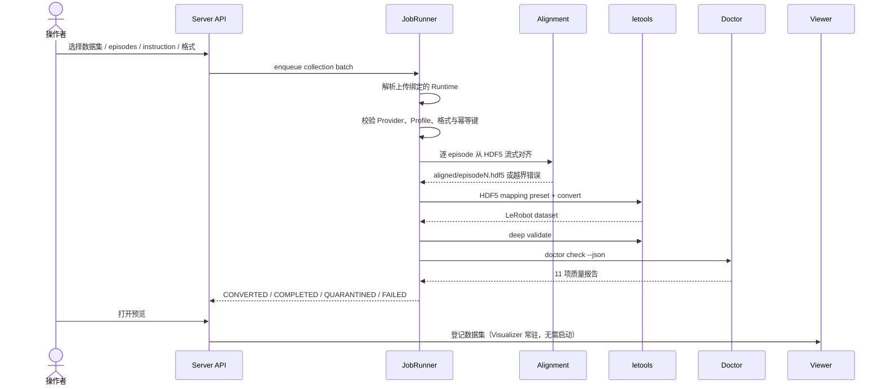

# 架构设计

本文描述 BodyPipeline 当前版本的运行时架构、数据契约和扩展边界。设计目标是让机器人侧采集与中心侧数据处理解耦，同时保持部署简单：不引入数据库、消息队列或前端构建系统。

## 1. 设计原则

1. **机器人侧只采集，不训练。** Client 调用机器人已有的 recorder，不接管机械臂驱动、运动控制或急停。
2. **ROS2 隔离。** 只有 Bridge 依赖 ROS2 / `rclpy`；Client、Server 和工具链使用独立的 uv 环境。
3. **封存数据不可变。** `episode.hdf5` 一旦封存即作为原始数据边界保留；recorder 的逐帧临时目录只用于封存，上传 ACK 后可清理。时间对齐、转换和质检都使用独立输出目录。
4. **文件系统即持久层。** 状态使用原子写入的 JSON，数据使用目录和 Manifest；不需要数据库。
5. **按数据集组织 episode。** 同一任务描述、机器人 Profile、操作方式、原始格式和存储目标组成一个 collection，每次采集追加一个 episode。
6. **转换与安全解耦。** 数据管线不执行关节软限位或 URDF 运动学门禁；限位由控制器、规划器和安全层负责。
7. **差异化适配集中在边界。** 机器人差异应落在 Adapter、Bridge、Profile、Server Provider 和测试中，而不是散落到页面和主流程。

## 2. 部署单元

```mermaid
flowchart TB
    operator["操作者浏览器"]

    subgraph robot_host["机器人主机"]
        client["Client<br/>FastAPI :8080"]
        bridge["ROS2 Bridge<br/>FastAPI :8090 / loopback"]
        recorder["机器人 Recorder / 驱动"]
        state[("Client state<br/>JSON")]
        captures[("本地 captures<br/>raw + manifest")]
        client --> state
        client --> captures
        client --> bridge
        bridge --> recorder
        recorder --> captures
    end

    subgraph server["中心服务器"]
        server["Server<br/>FastAPI :8081"]
        state2[("Server state<br/>JSON")]
        data[("data_root<br/>incoming / raw / work")]
        tools["letools<br/>convert / validate / doctor"]
        gateway["Viewer Gateway<br/>:8082"]
        visualizer["LeRobot Visualizer<br/>:3100 + :8765"]
        imports[("import_roots<br/>历史原始数据 / LeRobot")]
        server --> state2
        server --> data
        server --> tools
        server --> gateway
        gateway --> visualizer
        data --> visualizer
        imports --> server
        imports --> visualizer
    end

    operator -->|管理登录| client
    operator -->|管理登录| server
    operator -->|无鉴权只读入口| gateway
    client -->|设备鉴权 / 分块上传| server
```

本地演示还会启动一个 Mock Adapter，替代 Bridge 和真实 recorder。Server 的 `processing_mode=demo` 会执行上传、分组和模拟对齐，但不会伪造 LeRobot 转换或 Doctor 结果。

## 3. Client 架构

### 3.1 进程与职责

Client 是单个 FastAPI 进程，内部由以下模块组成：

| 模块 | 职责 |
| --- | --- |
| `CaptureService` | 采集会话状态机、数据目录、封存、保留 / 丢弃、健康检查 |
| `CaptureAdapter` | 统一采集服务与预览接口 |
| `ReplayService` | 通用回放状态、进程、进度、停止、采集互斥 |
| `ReplayProvider` | 按本机 Profile 绑定的机器人轨迹格式、语义映射与执行接口 |
| `UploadAgent` | 上传队列、断点续传、重试、回执持久化 |
| Web UI | 相机预览、存储选择、采集操作、上传进度 |

Client 不启动机器人驱动。采集路径不发送运动指令；用户启动回放后，由独立 `ReplayProvider` 调用该机器人的既有执行工具。`Ros2Adapter` 通过本机 HTTP 调用 Bridge；Bridge 再调用机器人现有的 ROS2 CaptureService 并订阅状态与图像 topic。

### 3.2 采集状态机



关键约束：

- `start` 只有确认 recorder 已进入录制状态后才返回成功。
- `stop` 的成功必须表示 writer 已停止或已排空，不能只表示请求已受理。
- 结果未知时进入 `RECOVERY_REQUIRED`，禁止盲目重发 `start`。
- 同一 Client 同一时间只允许一个采集 owner。
- 丢弃不是物理删除，当前版本把数据移入 `discarded/` 供审计和恢复。

### 3.3 数据集与目录

collection ID 由任务名称、项目、机器人类型、Profile 摘要、采集模式、原始格式、目标和子目录共同决定。因此同名但语义不同的任务不会被错误合并。

```text
<local_root>/<subdir>/datasets/<collection_id>/
└── sessions/<capture_id>/
    ├── manifest.json
    ├── episode.hdf5
    └── raw/episode0/                 # 封存源；上传 ACK 后清理
        ├── camera/color/<camera_id>/*.jpg
        └── arm/jointState/<stream>/*.json
```

封存时 Client 会：

- 校验时间戳流、JPEG 可解码性和 7 维有限 joint position；
- 把相机 JPEG 与关节时间序列打包成单个 `episode.hdf5`；
- 对 HDF5 执行 `fsync`，计算整文件 SHA-256；
- 拒绝符号链接、空数据和缺失相机；
- 写入仅登记 `episode.hdf5` 的 Manifest；
- 仅在保留成功后把上传任务加入队列；远端 ACK 后才清理本地 `raw/episode0/`。

当前 AgileX v1 包结构：

```text
/metadata
/streams/camera/<camera_id>/timestamps      float64[N]
/streams/camera/<camera_id>/jpeg            vlen uint8[N]
/streams/arm/jointState/<stream>/timestamps float64[N]
/streams/arm/jointState/<stream>/position   float32[N, 7]
```

根属性包含 schema、`raw_format=agilex_joint_camera_hdf5_v1` 和 robot type。Manifest 只登记一个 `episode.hdf5` 及整文件 SHA-256。上传 ACK 后清理的是 recorder 的 `raw/episode0/`；HDF5 与 Manifest 保留，上传失败时两者和临时目录都保留。单文件传输减少目录和 RPC 开销，但 JPEG 不做二次编码压缩，因此不承诺显著减少网络字节数。

### 3.4 预览与采集解耦

预览通过 `frame(camera_id)` 获取最新 JPEG，页面以低分辨率轮询。预览失败不会终止录制；预览正常也不证明原始流完整或时间同步。Bridge 会记录 topic 新鲜度，Client 健康检查会暴露 `topic_ages` 等状态。

## 4. Server 架构

### 4.1 接收与数据集分组

设备通过独立的 `PIPELINE_DEVICE_TOKEN` 或设备注册表中的 `token_env` 上传。Server 校验：

- 上传所属的 `robot_id`、`project_id`；
- Manifest schema、文件数量、路径安全与大小限制；
- 每块和完整文件 SHA-256；
- 断点偏移和最终提交一致性。

上传完成后，Server 根据 collection 元数据把 episode 分组。数据集名称只用于展示和 Manifest；磁盘目录使用稳定 ID，不直接使用用户输入的路径。

### 4.2 转换任务



批量转换要求所有 episodes 属于同一数据集、同一 Runtime、机器人类型和 Profile。任务记录保存 `lineage.json`，包括来源 upload、Manifest 摘要、instruction、`runtime_id`、Provider、Profile 摘要、目标格式和 synthetic 标记。相同输入、指令、Runtime、Profile 和工具版本会复用未失败任务，保证重试幂等。

一个任务最多包含 1000 个 episodes。Server 先为每个来源生成独立的 `aligned/episodeN.hdf5`，再调用一次 letools 转换成一个 `dataset`；输出 `meta/info.json` 的 `total_episodes` 必须等于来源数量，`total_frames` 必须等于整批对齐帧数之和。任一 episode 核验或对齐失败时，任务停止在转换前并保留 `episode_diagnostics`，不会静默跳过坏数据。

### 4.3 Runtime / Provider 路由

Server 的可信边界如下：

```text
认证设备身份
→ Server 静态 RuntimeCatalog
→ Profile + raw_formats + Provider
→ Provider 对齐 / 质量策略 / letools 参数
→ 统一 JobRunner
```

关键约束：

- Runtime 只能来自 `configs/server*.json` 的 `profiles`（旧版单 `profile_path` 会映射为 `default`）。
- Provider 只能从 `pipeline/server/providers/registry.py` 的静态注册表获取。
- 设备注册表的 `profile` 字段绑定 Runtime；Manifest 自报的 `robot_type`、`raw_format` 和 Profile 摘要仅用于校验。
- 上传记录保存 `runtime_id` 和 `provider`。旧记录没有这些字段时，按 `robot_type + Profile hash` 兼容解析；不能唯一解析时阻断转换。
- 批量任务一旦发现多个 Runtime 直接拒绝，不允许跨机器人合并。
- Provider 自己负责 Profile schema、原始布局、对齐和质量元数据；`JobRunner` 只负责通用编排、快照、letools Doctor 和结果状态。

当前只有 `AgileXProvider` 正式注册。新增机器人应新增 Provider、Profile、配置绑定和测试，不应在 `jobs.py` 中增加机器人型号条件分支。

### 4.4 时间对齐

`AgileXProvider` 对单文件 HDF5 使用 `prepare_agilex_hdf5()`；旧目录格式仍由 `prepare_agilex()` 兼容读取。当前约束（其他机器人可声明不同布局）：

| 项目 | 当前值 |
| --- | --- |
| 输出帧率 | 30 Hz |
| 相机 | `left`、`front`、`right` |
| 相机匹配 | 最近帧，最大偏差 20 ms |
| state | `puppetLeft`、`puppetRight`，因果保持 |
| action | `masterLeft`、`masterRight`，因果保持 |
| 关节保持上限 | 50 ms |
| 每路维度 | 7，双臂合计 14 |
| 最短帧数 | 30 |

对齐器直接在原始 HDF5 的相机和关节流上生成公共时间区间与统一网格，输出单个 `aligned/episodeN.hdf5`，不解包出原始目录。任何流超过阈值都会拒绝整个 episode，并在任务诊断中给出具体 episode、流、帧号和误差。

这些阈值是数据质量策略，不是机器人运动安全限制。若现场出现越界，应检查 recorder、时间戳和流连续性，不能为了通过而直接放宽阈值。

### 4.4.1 内容分析（Argus）

`AnalysesRunner` 是独立于转换与 Doctor 的第三类后台任务：给定一份已转换数据集，
用固定提交的 Argus 工具链做确定性检查，可选地再做视觉语言模型语义标注。

关键边界：

- **独立环境**：Argus 固定 Python 3.11，与 letools 的 3.12 隔离；通过子进程调用，
  主服务依赖不受影响。
- **只读输入**：分析产物写入 `analyses/<analysis_id>/`，不修改数据集、不改变任务状态。
- **事实来自 Server 配置**：相机的安装关系、状态语义由 Provider 的
  `analysis_context()` 从受信任 Runtime Profile 提供；数据集自报字段只做校验。
  未声明的安装关系导致相关检查"未评估"，而不是被静默跳过或假设。
- **预算**：任务额度按 `min(任务上限, 每 episode 额度 × episode 数)` 计算，
  每日额度按本地零点结算；预算不足只影响付费标注，本地检查仍会完成。

### 4.5 质检策略

转换后的检查分为三层：

1. **结构检查：** 数据集元信息、episode 数量、帧数、视频和 Parquet 可读取性。
2. **deep validate：** 通过 letools 校验 LeRobot 目录结构、schema 和媒体。
3. **Doctor：** 固定执行 11 项非运动学检查：metadata、temporal、actions、videos、statistics、episodes、consistency、training、anomalies、portability、per_episode。

Doctor 结果只作为报告和任务状态依据。`WARN` / `FAIL` 结果仍保留数据集，便于预览和排查。数据管线不执行：

- 关节或夹爪软限位门禁；
- URDF 正运动学 / 逆运动学可行性检查；
- 自动裁剪、插值、修复或删除 episode。

### 4.6 数据目录

```text
<data_root>/<robot_type>/
├── incoming/<upload_id>/
├── raw/<target>/<prefix>/collections/<collection_id>/episodes/<upload_id>/data/episode.hdf5
└── work/<job_id>/
    ├── aligned/episodeN.hdf5       # 每个来源 episode 一个对齐文件
    ├── letools-hdf5-preset.json    # 本批次 HDF5 字段映射
    ├── dataset/                    # 单个 LeRobot v2.1 / v3.0 数据集
    ├── checks/<check_id>/          # 独立质检日志与报告
    ├── alignment-report.json
    ├── robot-report.json
    ├── lineage.json
    └── *.log
```

转换结果固定为 `work/<job_id>/dataset`，没有额外的数据集晋级或导出阶段。旧任务中记录的既有结果路径可以作为只读兼容入口，但不会移动或重写。

## 5. 历史数据导入

`ImportService` 允许管理员把 Server 上已有数据原地登记：

| 输入 | 识别方式 | 后续 |
| --- | --- | --- |
| 当前原始采集 | `manifest.json` + `episode.hdf5` | 进入 HDF5 对齐和批量转换 |
| 历史原始采集 | `manifest.json` + `data/episode0` 或 `raw/episode0` | 旧格式兼容转换 |
| 历史 LeRobot | `meta/info.json` 且 `codebase_version` 为 v2.1 / v3.0 | 直接进入预览和 Doctor |

安全边界：

- 路径必须是绝对路径；
- 必须位于 `import_roots` 或 `data_root` 白名单；
- 拒绝符号链接；
- 原始 Manifest 中的文件路径必须被限定在源目录内；
- 不改写源目录，重复导入按内容摘要幂等；
- `robot_type` 冲突时拒绝，而不是静默覆盖。

## 6. 身份、网络与安全

| 凭据 | 使用方 | 作用域 |
| --- | --- | --- |
| `PIPELINE_TOKEN` | 人或管理脚本 | Client / Server 登录 |
| `PIPELINE_DEVICE_TOKEN` | Client | Server `/device/*` 上传接口 |
| `PIPELINE_BRIDGE_TOKEN` | Client ↔ Bridge | 只允许 loopback |

补充约束：

- 管理密钥与设备密钥必须不同且至少 24 字符。
- 多设备部署使用 `devices` 注册表，每台设备独立 `token_env`。
- Cookie 使用 HttpOnly、SameSite=Strict；写请求检查 Origin。
- Bridge 强制监听 `127.0.0.1` 或 `::1`。
- 所有服务固定单 worker，避免同一状态目录并发写。
- Viewer 入口与 Server 共用 `PIPELINE_TOKEN`；仍建议只监听内网或 Tailscale 地址。
- 当前没有 OIDC、RBAC、多租户隔离或分布式任务队列。

## 7. 文件状态与恢复

业务状态使用 `Store`：

```text
root/state/<kind>/<id>.json
```

写入流程为临时文件、`fsync`、原子替换、父目录 `fsync`。跨文件或跨目录操作使用意图状态和启动恢复扫描：

- 未完成上传可以按 offset 续传；
- `RUNNING` 转换任务在重启后标为 `INTERRUPTED`，需显式重试；
- 未完成封存会重新校验已保留数据；
- Server 启动时拉起常驻 Visualizer，重启时回收上一次遗留的进程；预览链接按 TTL 过期；
- 每个数据根由 `flock` 限制为单写进程。

文件持久化适合单机 MVP，不代表 NFS 并发一致性或异地备份已经解决。

## 8. 扩展点

| 变化 | 扩展位置 |
| --- | --- |
| 新 ROS2 service / topic / 消息 | `pipeline/client/bridge.py`、`pipeline/client/adapters/ros2.py` |
| 新采集后端 | 新增 `CaptureAdapter` 实现 |
| 新相机 / 关节布局 | Client packager、Manifest、Provider prepare/quality/conversion_args、Runtime 配置 |
| 新单文件 HDF5 schema | `pipeline/shared/hdf5.py`、Client packager、Ingest、Provider 与 fixture 测试 |
| 新原始格式 | `raw_format`、Ingest 校验、ImportService、Runtime Provider |
| 新 letools 输入格式 | 独立 Server Provider + letools source-format，不在页面中分支 |
| 多机器人共用 Server | 设备到 Runtime / Profile / Provider 的可信路由 |
| VR / 手柄 / 自动控制 | 增加操作输入、action 语义、事件 schema、Profile 与验收测试 |

新增机器人不应直接修改 HTML / JavaScript 来分支机器人类型。页面只消费统一 API；差异应在数据契约和适配器边界内处理。

详细文件清单见[新机器人适配指南](robots/new-robot-adaptation.md)。
