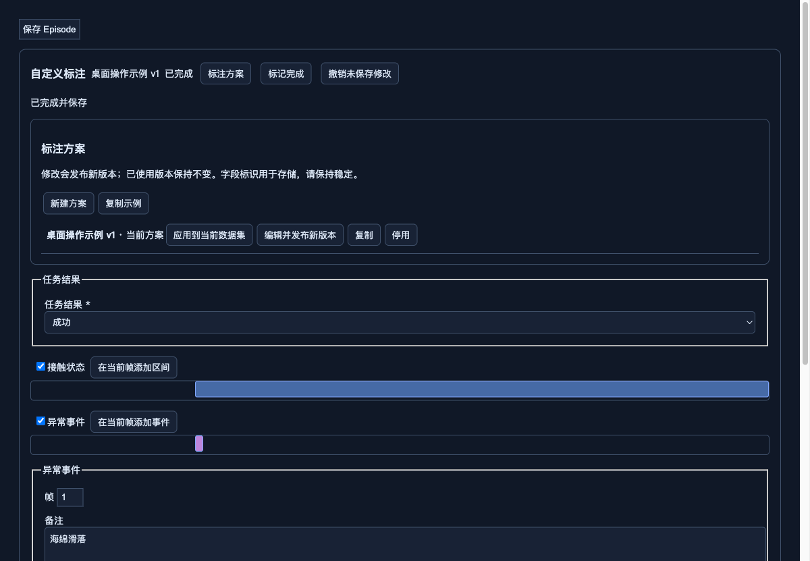

# 自定义人工标注

标注功能位于已转换或已导入数据集的 Visualizer“标注”页。它与原有的 TASK AUG、SUBTASK、PLAN、MEMORY、SPEECH 和 VQA 共用视频、时间轴和服务端保存；不改变原始采集或转换数据。

## 开始标注

1. 从 Server 工作台打开数据预览，进入“标注”页。
2. 打开“标注方案”，创建方案和类型；类型范围可选整个 Episode、时间区间或单帧。
3. 为类型添加字段，设置名称、显示控件、必填项、默认值及选项/数值范围。字段支持文本、整数、小数、布尔、单选、多选。
4. 保存方案，并将确定版本应用到当前数据集。示例方案不会自动应用，未标注也不会默认视为成功。
5. 填写 Episode 属性，在当前帧添加事件或设置区间边界。`subtask` 区间类型的字段会附加到已有子任务，其他类型使用独立记录。
6. 点击“保存 Episode”保存草稿；检查完整后标记完成。完成检查包含必填值、字段类型、选项、时间范围和同类区间重叠规则。
7. 筛选状态及字段值，导出标注包；默认只导出已完成且不在回收站的数据。

字段标识是稳定存储键；显示名称可与它不同。方案发布后不可原地覆盖，编辑会创建新版本。已有数据只接受兼容升级（增加可选字段/选项、放宽约束和显示调整）；不兼容的版本不能静默覆盖旧值。停用方案不删除历史版本。

## 保存、冲突和时间

一次保存包含当前 Episode 的语言标注、自定义属性、区间及事件。服务端返回成功才算完成保存；浏览器缓存仅保护未保存内容。编辑已完成记录会重新进入草稿。共享管理凭据不能识别真实操作者，记录时间与版本不等同于个人审计。

标注绑定持久 Episode 身份；界面中的 Episode 编号不是永久身份。区间存储使用 `[start_frame,end_frame)`，结束边界可为总帧数。时间定位读取数据中的实际时间戳，不使用 FPS 猜测。若来源缺少有效帧时间戳，须修复来源后再标注。

多个窗口修改同一数据集时使用全局 revision 检查；冲突返回 409，保留本地未保存内容并要求重新核对。不要反复点击保存覆盖其他窗口。旧客户端省略自定义字段时保留旧值；若无条目 ID 的旧客户端修改了带自定义字段的子任务且无法明确关联，会拒绝操作。

## 导出与重新使用

“标注包”是独立 ZIP，包含方案快照、Episode 身份、字段/语言标注、帧时间戳、来源清单和标注版本，不包含视频或机器人原始数据。

- 元数据和 Parquet 的 SHA256 用于校验配套来源；视频仅列出相对路径及大小，不宣称字节一致性校验。
- `source_signature` 是本机 inode/大小/mtime 的并发校验，不是跨机器内容身份。
- 独立 ZIP 包的再次导入不属于本次交付范围。
- 现有“生成修订数据集”仍保留全部 Episodes，并在新的数据副本中附带人工标注 sidecar；不会按标注包的默认完成状态筛选。
- 修订副本作为新的数据集独立编辑，保留原数据和 Episode 身份血缘，不与来源共用工作区。
- 首次打开包含有效 custom sidecar 的数据集，会校验方案和帧对应关系后恢复标注；无效的 sidecar 明确报错，不猜测匹配。

标签不会自动成为训练 prompt。训练端须明确哪些字段作为输入、监督目标或筛选条件，避免把最终结果和未来状态泄漏给较早帧。

## 回收站与数据变化

软删除保留标注，恢复后继续使用。永久清理时，存活 Episode 的身份不变，索引和数据集内 sidecar 同步重排；被删除记录归档。清理发生中断时，恢复事务完成后才可继续编辑。整数据集删除归档工作区。

外部工具改动数据集或重新转换，不会自动继承人工草稿；来源签名不匹配时停止编辑和导出，须先核对数据版本。

## 运维与验证

方案和索引保存在服务状态目录；人工标注正文及历史在 Server 管理的数据目录 `annotations/manual/<dataset_uuid>` 下，导出位于 `annotations/manual-exports/`。备份应同时包含服务状态和数据目录。保留现有单写进程、认证、路径白名单和同源写操作要求。

部署后需重启 Server/Viewer，Viewer 构建指纹包含新交互组件。无需重新转换原数据。Linux 上验证真实永久清理及中断恢复，本地跳过可选 LeTools 测试不代表这些验证已经通过。

## 界面示例与验证范围

下图来自真实组件与统一保存 hook 的浏览器接口模拟测试，不是真实机器人数据验收。

本次开发已运行 Python 全套测试、Bun 模型测试、实际固定版本 Viewer 的 TypeScript 检查与生产构建，以及模拟接口的浏览器完整操作测试。Linux 的真实永久清理和真实机器人数据人工验收需在合并前补齐；可选工具链跳过的测试不记为通过。PR 中提供准确命令和数量。
