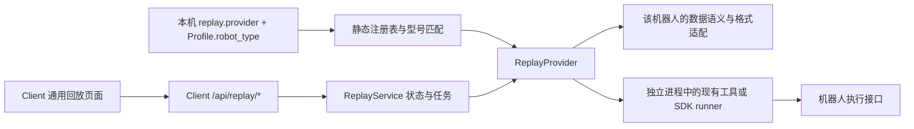

# 多机器人 Client 回放适配

回放遵循与现有采集/转换相同的边界原则：通用流程固定，机器人差异集中到独立 Provider，由可信部署配置绑定。它不复用 Server 转换 Provider 执行运动，Server 无回放转发接口。



每台机器人一套 Client。共享 Server 的设备身份 → Runtime → 转换 Provider 路由保持原样。Client 从本机 Settings 加载 Profile，并用其 `robot_type` 验证回放 Provider；浏览器、文件里的型号字符串、Manifest 均不能选择执行代码。

## 职责边界

| 层 | 管理的内容 | 不应放入的内容 |
| --- | --- | --- |
| CaptureAdapter | 开始/停止采集、预览、采集服务状态 | 回放运动控制 |
| ReplayService | 根目录约束、采集记录、幂等任务、采集互斥、进程与恢复、通用进度 | HDF5、双臂字段、关节维度、ROS topic、厂商路径 |
| ReplayProvider | 输入文件识别、时间/单位/顺序/动作语义、适配、执行 argv、日志解析 | Server 上传/转换、网页、公共会话逻辑 |
| Server RobotProvider | 对齐、转换、质量检查、训练数据血缘 | 真机回放与运动指令 |

## 契约与文件位置

入口：`pipeline/client/replay_providers/base.py`。

| 契约 | 约束 |
| --- | --- |
| `capabilities` | 固定 id/version、支持的 robot_types、file_extensions、展示文案、simulated 和进度超时 |
| `__init__(config, profile)` | 接收可信部署配置和本机 Profile；不在构造时运动 |
| `probe(path)` | 只读验证格式与机器人语义；返回 supported、frames、format、description，fps 可省略；特有信息放 metadata |
| `prepare(path, cache)` | 不运动、不改原始数据；返回给执行工具的文件路径 |
| `command(path)` | 返回 argv 数组；依赖 ROS/SDK 的逻辑放在独立 runner，不能把阻塞硬件调用塞进 API 线程 |
| `frame(line)` | 将工具日志归一为连续的、从 0 开始的已提交帧序号；非进度行返回 None |
| `error(line)` | 识别该工具的失败输出，返回错误说明或 None |

通用服务按声明的超时判断进度中断。收到全部帧后结束本任务进程组，表示“全部帧已提交”，不宣称机械臂已经精确到位。SDK runner 必须能够响应进程退出并按其工具契约释放资源；驱动和急停不由通用回放服务管理。当前契约面向有限轨迹、独立进程执行，尚不支持暂停/续播或必须常驻的 SDK 会话。

输入不要求 HDF5，也不要求 14 维或固定帧率。各 Provider 自行解释时序，绝对位置、速度、增量和事件流不能直接套用 AgileX 的因果保持。当前文件浏览支持 Provider 声明的文件扩展名；目录型数据集需要先提供入口文件或扩展通用输入契约。

## 注册和配置

1. 新建 `pipeline/client/replay_providers/<robot>.py`，实现契约和必要的 runner。
2. 在 `registry.py` 的可信代码中调用 `register_provider(YourReplayProvider)`；不支持从请求或配置动态 import。
3. 本机 Profile 设置已核实的 `robot_type`，Client 配置显式指定 `replay.provider`。启用回放却不指定 Provider、未知 Provider、机器人类型不匹配都会报错；不会回退成松灵。
4. Provider 未配置且回放未启用时，Client 采集/上传仍可使用，页面明确说明回放未配置。
5. 声明 simulated 的 Provider 只允许 mock Client。现有 `simulated` 是 AgileX 格式的离线模拟器，不代表任意机器人均可模拟。

松灵已验证的配置保持兼容：

```json
{
  "replay": {
    "enabled": true,
    "provider": "agilex_tool",
    "trajectory_source": "state",
    "roots": {"episodes": "/home/agilex/data_episode"}
  }
}
```

`trajectory_source` 属于 AgileX Provider 的配置，不是通用机器人协议。松灵 `state` 使用 puppetLeft/puppetRight，输出仍复用原工具的控制话题；原 action/state 数据不改写。映射代码、HDF5 格式、运行环境脚本均在 `replay_providers/` 中。

缓存目录先按 Provider id/version 隔离：`replay-cache/<id>/<version>/`，内部内容寻址由各 Provider 管理。变更输入解释或执行映射时增加版本，缓存键需包含影响输出的源文件、Profile/配置语义。任务记录保存 provider_id、provider_version、robot_type 和 source_metadata；旧任务状态仍可读取，服务重启不自动重播。

## 接入一个新机器人需要核实什么

- 一份真实轨迹及对应数据格式、关节/位姿/速度含义、顺序、单位、坐标系和时间戳。
- 已有执行工具或 SDK 入口及其启动、进度、错误、退出协议。
- 示教输入、下发命令和实际反馈的区别；选择回放来源不能更改训练数据标签。
- 记录与执行端的型号兼容关系。文件带有不匹配的机器人元数据时拒绝；旧格式无型号元数据时由适配器的显式格式约束和部署绑定负责，不把维度相同视为兼容。

只增加 Provider、runner、注册项、Profile/配置与测试即可接入符合本契约的新机器人，无需修改页面、API、任务状态机、上传层或 Server。特定机器人需要新交互或长驻控制协议时，应扩展契约，不能伪装成已支持。

## 验证及当前支持范围

- 真实 Provider：AgileX ALOHA，复用已有工具；现场 puppet 回放曾由用户确认成功。本次抽离后的版本仅本地验证，待机器人开机再部署。
- 离线 Provider：AgileX 格式模拟，打印进度，不导入 ROS 或调用硬件。
- 扩展性 fixture：测试中注册三轴机器人，使用 JSON `.traj`、非均匀时间戳、自定义进度协议，经相同 Client API 完成任务；fixture 不注册到产品，不宣称 ARX 或其他真机已适配。
- 回归覆盖：型号不匹配、未知/缺省 Provider、禁用能力、模拟能力限制、跨版本缓存隔离、非 HDF5 文件浏览、无 source_arms 的新 Provider、幂等任务、旧 AgileX 数值映射/停止/恢复。

新增实际 Provider 时必须补充其格式/单位/时序正负样本、退出与失败行为，并按授权完成现场验证。采集、转换和回放分别报告支持状态。
